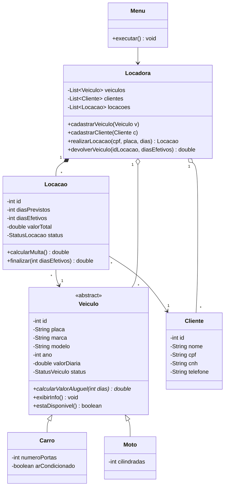

# 🚗 Locadora de Veículos — Java

Aplicação console de uma locadora de veículos, desenvolvida em **Java** com os paradigmas da **Programação Orientada a Objetos**.

Este projeto faz parte de um trabalho acadêmico em que o mesmo sistema é implementado em três linguagens: **Java**, **Python** e **C**. As três versões seguem o mesmo diagrama de classes e as mesmas regras de negócio.

---

## Funcionalidades

- Cadastro de **carros** e **motos**
- Listagem de todos os veículos e apenas dos disponíveis
- Cadastro e listagem de **clientes**
- **Locação** de veículos, com cálculo do valor previsto
- **Devolução** com cálculo de multa por atraso
- Listagem das locações ativas
- Validação de entradas (placa e CPF únicos, números inválidos, veículo indisponível etc.)

---

## Estrutura do projeto

```
LocadoraVeiculos/
└── src/
    ├── StatusVeiculo.java   # enum: DISPONIVEL, ALUGADO, MANUTENCAO
    ├── StatusLocacao.java   # enum: ATIVA, FINALIZADA
    ├── Veiculo.java         # classe abstrata
    ├── Carro.java           # herda de Veiculo
    ├── Moto.java            # herda de Veiculo
    ├── Cliente.java
    ├── Locacao.java         # associa Cliente e Veiculo
    ├── Locadora.java        # listas e regras de negócio
    ├── Menu.java            # interação com o usuário (console)
    └── Main.java            # ponto de entrada
```

---

## 🧩 Diagrama de classes



---

## Pilares da Orientação a Objetos

| Pilar | Onde aparece |
|---|---|
| **Encapsulamento** | Todos os atributos são `private`, com acesso por getters e setters. Apenas o que pode mudar depois do cadastro tem setter. |
| **Herança** | `Carro` e `Moto` estendem `Veiculo` (`extends`). |
| **Abstração** | `Veiculo` é `abstract`: não é possível instanciar um veículo genérico. |
| **Polimorfismo** | `calcularValorAluguel()` e `exibirInfo()` são sobrescritos (`@Override`) em cada subclasse. `Locacao` e `Locadora` trabalham com `Veiculo` sem saber se é carro ou moto. |
| **Associação / Composição** | `Locacao` referencia um `Cliente` e um `Veiculo`; `Locadora` mantém as listas de veículos, clientes e locações. |

---

## Regras de negócio

**Valor do aluguel**
- **Carro:** `valorDiaria × dias`, mais `R$ 15,00 × dias` se tiver ar-condicionado
- **Moto:** `valorDiaria × dias`, com acréscimo de **10%** se `cilindradas > 500`

**Devolução e multa**
- `diasExtras = diasEfetivos − diasPrevistos` (mínimo 0)
- `multa = diasExtras × valorDiaria × 1,5`
- `valorTotal = calcularValorAluguel(diasEfetivos) + multa`

**Validações**
- Placa e CPF não podem se repetir
- Só é possível alugar um veículo com status `DISPONIVEL`
- A quantidade de dias deve ser no mínimo 1
- Ao alugar, o veículo passa para `ALUGADO`; ao devolver, volta para `DISPONIVEL` e a locação fica `FINALIZADA`

---

## Como executar

**Requisito:** Java **14** ou superior (o projeto usa `switch` com `->`).

Pelo terminal, na pasta do projeto:

```bash
# compilar
javac -d out src/*.java

# executar
java -cp out Main
```

Ou abra a pasta em uma IDE (IntelliJ, Eclipse, NetBeans ou VS Code) e execute a classe `Main`.

---

## Menu

```
===== LOCADORA DE VEÍCULOS =====
1 - Cadastrar carro
2 - Cadastrar moto
3 - Listar veículos
4 - Listar veículos disponíveis
5 - Cadastrar cliente
6 - Listar clientes
7 - Realizar locação
8 - Devolver veículo
9 - Listar locações ativas
0 - Sair
Escolha uma opção:
```

### Exemplo de cálculo

Fiat Argo com ar-condicionado, diária de R$ 120,00, alugado por 3 dias e devolvido em 5:

| Item | Cálculo | Valor |
|---|---|---|
| Valor previsto | 120 × 3 + 15 × 3 | R$ 405,00 |
| Aluguel efetivo | 120 × 5 + 15 × 5 | R$ 675,00 |
| Multa | 2 × 120 × 1,5 | R$ 360,00 |
| **Total** | | **R$ 1.035,00** |

---

Trabalho desenvolvido para a disciplina de Paradigmas da Programação da faculdade Veiga de Almeida, 2026.
